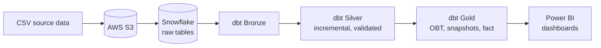
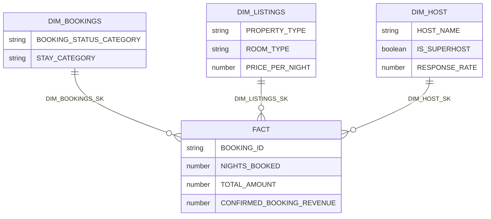
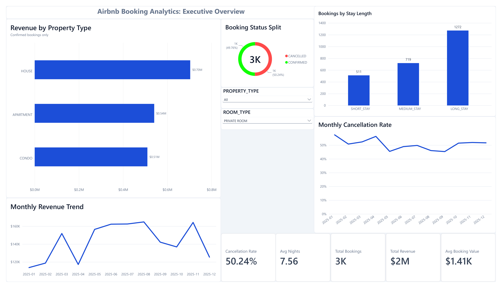
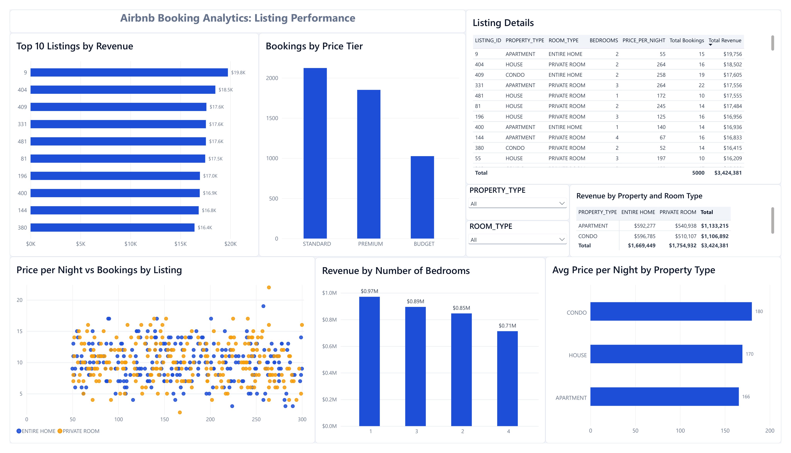
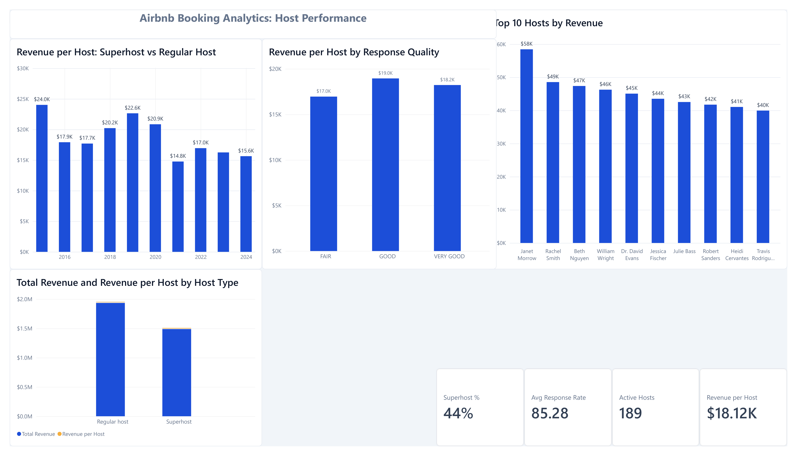

# Airbnb Analytics Pipeline: AWS S3 → Snowflake → dbt → Power BI


An end-to-end data engineering and analytics project. Raw Airbnb booking, listing and host data is loaded into **Snowflake**, transformed with **dbt** through a **Bronze → Silver → Gold** (medallion) architecture, modelled as a **star schema with SCD Type 2 snapshots**, and visualised in a three-page **Power BI** dashboard.

> **Note:** The dataset is synthetic. All figures and insights are for demonstration only.

## Table of contents
- [Highlights](#highlights)
- [Architecture](#architecture)
- [Tech stack](#tech-stack)
- [Data model](#data-model)
- [Dashboards](#dashboards)
- [Key insights](#key-insights)
- [Data quality and testing](#data-quality-and-testing)
- [Project structure](#project-structure)
- [Getting started](#getting-started)
- [Lessons learned](#lessons-learned)
- [Future improvements](#future-improvements)
- [Author](#author)

## Highlights
- **Medallion architecture:** raw data in Bronze, cleaned and validated data in Silver, analytics-ready models in Gold.
- **Incremental models:** Silver models use dbt's `merge` strategy with deduplication via `QUALIFY ROW_NUMBER()`.
- **Data quality flags:** every Silver row gets a `DATA_QUALITY_STATUS`, and only valid rows reach the Gold layer.
- **Config-driven One Big Table (OBT):** columns, joins and filters are defined in a single Jinja list, so adding a column is a one-line change.
- **SCD Type 2 dimensions:** `dim_bookings`, `dim_listings` and `dim_host` are dbt snapshots (timestamp strategy), so changes to a record are tracked over time.
- **Star schema fact table:** one row per booking, joined to the current version of each dimension through surrogate keys.
- **Reusable macros:** shared Jinja macros for text cleaning and status normalisation.
- **Testing:** generic tests (unique, not null, accepted values, relationships) plus a singular source test that warns instead of failing.
- **Power BI report:** a star-schema model, DAX measures, a custom theme and three analytical pages.

## Architecture



## Tech stack

| Layer | Technology |
|---|---|
| Storage | AWS S3 |
| Data warehouse | Snowflake |
| Transformation | dbt Core (`dbt-snowflake`) |
| Language | SQL, Jinja, Python 3.12+ |
| Environment | `uv` (see `pyproject.toml` and `uv.lock`) |
| Visualisation | Power BI Desktop (DAX) |
| Version control | Git and GitHub |

## Data model

| Layer | Models | What happens |
|---|---|---|
| **Bronze** | `bronze_bookings`, `bronze_listings`, `bronze_hosts` | Raw data materialised as tables |
| **Silver** | `silver_bookings`, `silver_listings`, `silver_host` | Incremental merge, deduplication, type casting, text standardisation, derived fields and data quality flags |
| **Gold** | `obt` | One Big Table: bookings joined with listings and hosts, valid rows only |
| | `bookings`, `listings`, `hosts` (ephemeral) | Dimension shapes taken from the OBT |
| | `dim_bookings`, `dim_listings`, `dim_host` (snapshots) | SCD Type 2 dimensions |
| | `fact` | One row per booking, with measures and surrogate keys |



**SCD Type 2 details:** snapshots use `strategy: timestamp` with `updated_at: CREATED_AT` and `dbt_valid_to_current: to_date('9999-12-31')`. The current version of every record has `dbt_valid_to = 9999-12-31`. The fact table joins to the current version through each snapshot's `dbt_scd_id`.

## Dashboards

The Power BI report contains three pages and uses the dbt gold layer through surrogate-key relationships. The report file and theme are in [`powerbi/`](powerbi/).

### Executive Overview
KPI cards (revenue, bookings, average booking value, average stay, cancellation rate), monthly revenue and cancellation trends, revenue by property type, stay length and booking status.



### Listing Performance
Top 10 listings by revenue, bookings by price tier, price versus bookings, revenue by property and room type, and revenue by number of bedrooms.



### Host Performance
Active hosts, superhost share, response rate, revenue per host by join year, response quality and host type, and the top 10 hosts by revenue.



### Key DAX measures
```
Total Revenue      = SUM('FACT'[CONFIRMED_BOOKING_REVENUE])
Total Bookings     = DISTINCTCOUNT('FACT'[BOOKING_ID])
Cancellation Rate  = DIVIDE([Cancelled Bookings], [Total Bookings])
Avg Booking Value  = DIVIDE([Total Revenue], [Confirmed Bookings])
Revenue per Host   = DIVIDE([Total Revenue], [Active Hosts])
Revenue MoM %      = DIVIDE([Total Revenue] - [Revenue PM], [Revenue PM])
```

## Key insights
*(From synthetic data, so treat these as an example of the analysis rather than real market findings.)*

- Confirmed-booking revenue totals about **$3.42M** across **5,000 bookings** and **189 active hosts**, roughly **$18K per host**.
- Roughly **50% of bookings are cancelled**, and the rate stays flat month to month.
- Revenue is spread almost evenly across property types: **House $1.18M**, **Apartment $1.13M**, **Condo $1.11M**.
- **Private rooms** earn slightly more in total (**$1.75M**) than **entire homes** (**$1.67M**).
- **Long stays** (8+ nights) are the largest group of bookings.

## Data quality and testing

- **Validation in the Silver layer:** rows are flagged (for example `INVALID_NIGHTS`, `INVALID_PRICE`, `BEDROOMS_EXCEED_CAPACITY`) instead of being silently dropped.
- **Generic tests:** `unique`, `not_null`, `accepted_values` and `relationships` across Silver and Gold, including surrogate-key checks on the fact table.
- **Singular test:** `tests/source_tests.sql` checks the raw layer for duplicates, invalid values and orphan keys in a single query, with `severity: warn`.

```bash
dbt test                              # run all tests
dbt test --select source_tests        # run the raw-layer test only
```

## Project structure

```
.
├── Snowflake_DDL/                 # Snowflake setup scripts
├── Source Data/                   # raw CSV files (bookings, listings, hosts)
├── aws_dbt_snowflake_project/
│   ├── models/
│   │   ├── bronze/
│   │   ├── silver/
│   │   └── gold/                  # obt.sql, fact.sql, ephemeral/
│   ├── snapshots/                 # dim_bookings, dim_listings, dim_host
│   ├── macros/
│   ├── tests/
│   └── dbt_project.yml
├── powerbi/
│   ├── Airbnb_Dashboard.pbix
│   ├── airbnb_analytics_theme.json
│   └── screenshots/
├── docs/                          # lineage graph
├── pyproject.toml
└── uv.lock
```

## Getting started

### Prerequisites
- Python 3.12 or later and [`uv`](https://docs.astral.sh/uv/)
- A Snowflake account (a free trial works)
- An AWS S3 bucket (optional if you load the CSVs another way)
- Power BI Desktop (Windows) to open the report

### 1. Clone and install
```bash
git clone https://github.com/MuhammadShaaf/airbnb-dbt-snowflake-pipeline.git
cd airbnb-dbt-snowflake-pipeline
uv sync
```
Activate the environment (`.venv\Scripts\activate` on Windows, `source .venv/bin/activate` on macOS or Linux).

### 2. Set up Snowflake
Run the scripts in `Snowflake_DDL/` to create the objects the project expects (the `AIRBNB` database with `BRONZE`, `SILVER` and `GOLD` schemas), then load the CSV files from `Source Data/` into the raw tables, either from S3 or with the Snowsight upload.

### 3. Configure dbt
Create `~/.dbt/profiles.yml`. **Never commit this file.**

```yaml
aws_dbt_snowflake_project:
  target: dev
  outputs:
    dev:
      type: snowflake
      account: <your_account_identifier>
      user: <your_user>
      password: "{{ env_var('SNOWFLAKE_PASSWORD') }}"
      role: <your_role>
      warehouse: <your_warehouse>
      database: AIRBNB
      schema: <your_schema>
      threads: 1
```

### 4. Build the project
```bash
cd aws_dbt_snowflake_project
dbt debug      # check the connection
dbt build      # run models, snapshots and tests in dependency order
```

To view the lineage graph, run `dbt docs generate` and then `dbt docs serve`.


### 5. Open the report
Open `powerbi/Airbnb_Dashboard.pbix` in Power BI Desktop, apply the theme from `powerbi/airbnb_analytics_theme.json` (Design → Themes → Browse for themes), point the Snowflake connection at your account and refresh.

## Lessons learned
- **Validate source semantics early.** Checking sample rows showed that `BOOKING_AMOUNT` is already the full stay price. Multiplying it by the number of nights had inflated total revenue roughly ninefold ($31.3M instead of $3.42M). The fix was made in the Silver layer and propagated through the Gold layer and Power BI.
- **Incremental models need a watermark.** Without an `is_incremental()` filter, a merge model still reprocesses the whole table on every run.
- **Snapshots require one row per key.** Dimension shapes taken from the OBT must be deduplicated first, because the OBT has one row per booking.
- **Surrogate keys keep history correct.** Relating the fact table to SCD2 dimensions on `dbt_scd_id`, rather than natural IDs, prevents duplicate matches once a record has multiple versions.

## Future improvements
- Add a proper date dimension and a daily bookings view
- Orchestrate the pipeline with Airflow or Dagster
- Add CI with GitHub Actions to run `dbt build` on pull requests
- Add a Streamlit app with a price prediction model trained on the gold layer
- Publish dbt docs to GitHub Pages

## Author
**Muhammad Shaaf** · [GitHub](https://github.com/MuhammadShaaf) · [LinkedIn](https://www.linkedin.com/in/muhammad-shaaf/)
